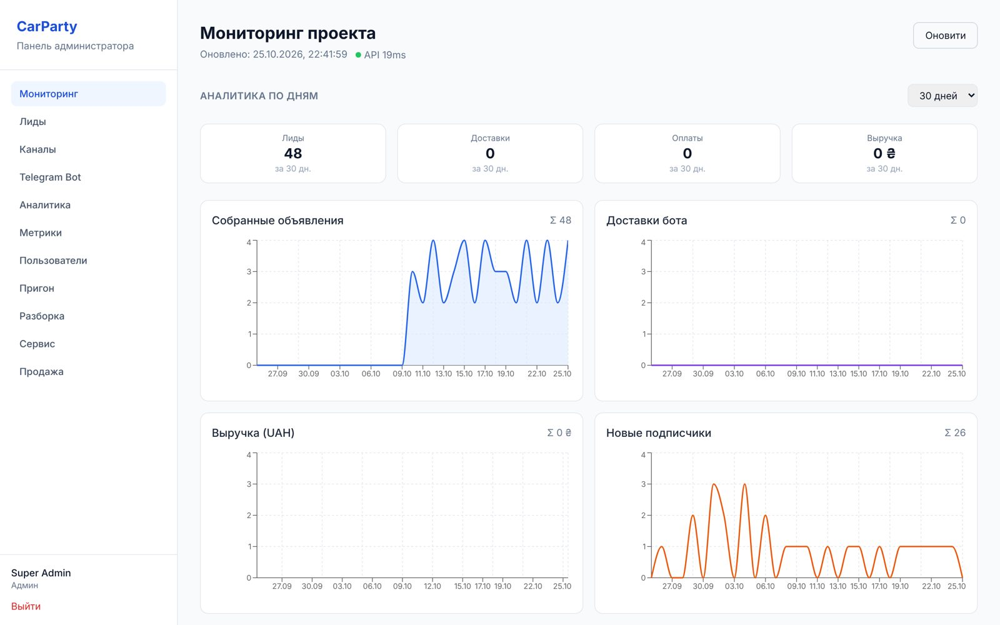
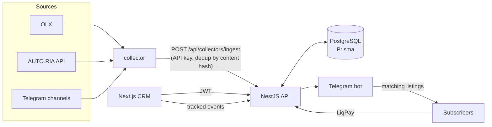
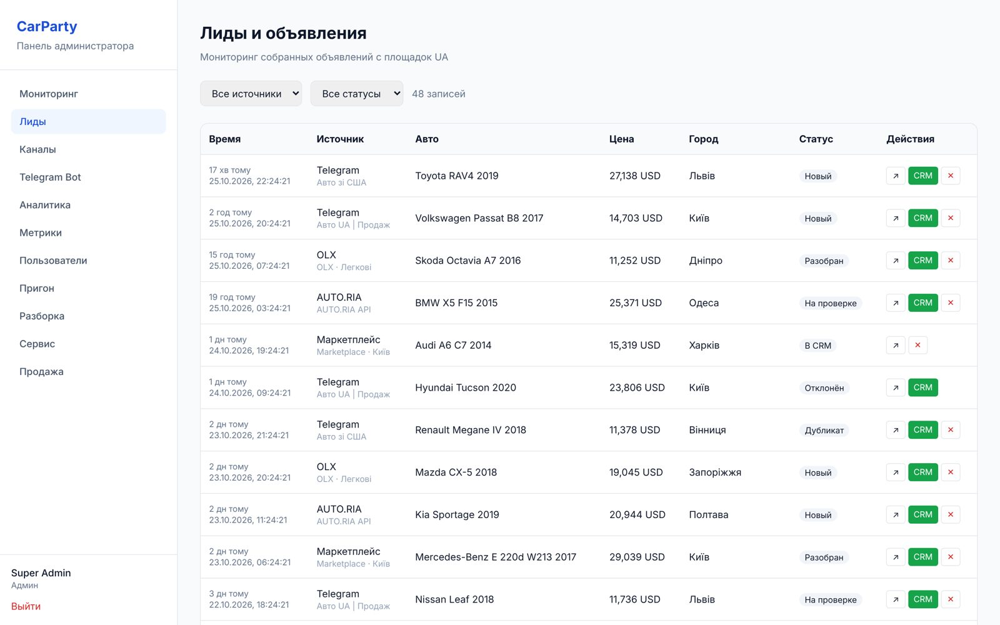
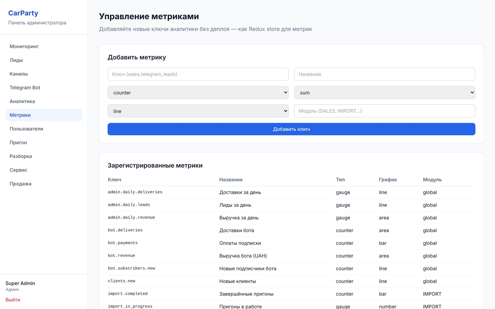
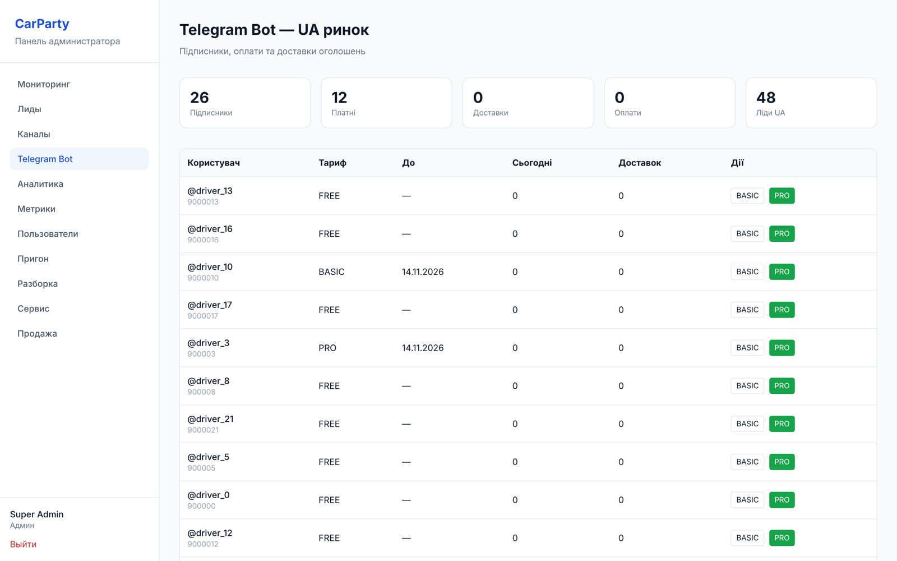
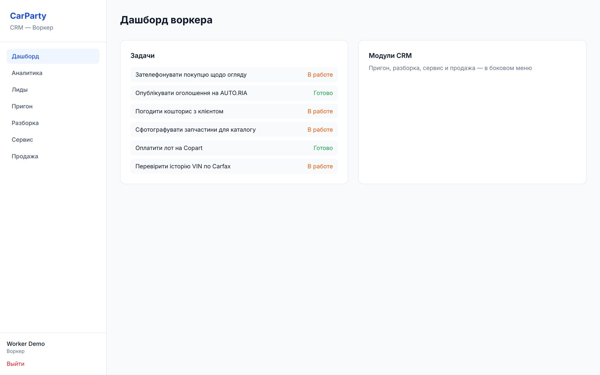
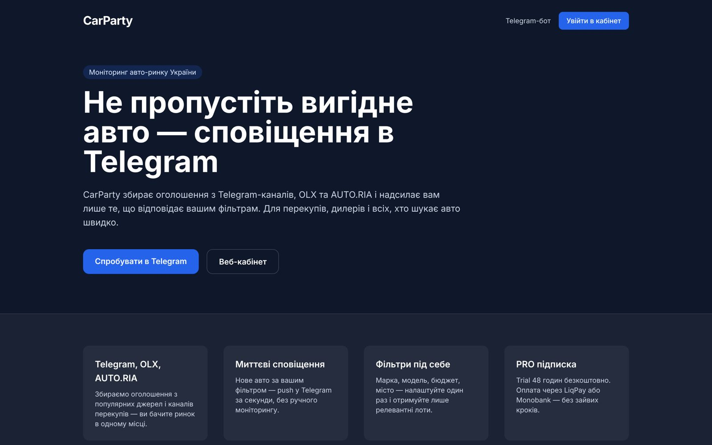

# CarParty

Car-listing monitoring and dealer CRM for the Ukrainian market. Collectors pull listings from OLX, AUTO.RIA and Telegram channels; a Telegram bot pushes the ones that match each subscriber's filters; the CRM runs the dealer's whole pipeline — import from auctions, dismantling, service and sales.



## What's inside

| Part | Stack | Responsibility |
|------|-------|----------------|
| `apps/api` | NestJS, Prisma, PostgreSQL | REST API, JWT auth with three roles (client / worker / super admin), listing ingest, LiqPay callbacks, analytics aggregation |
| `apps/web` | Next.js 14 (App Router), Tailwind | CRM: leads, import requests, dismantling and parts, service orders, sales and deals, metrics dashboards |
| `apps/landing` | Next.js 14 | Marketing site for the bot |
| `apps/collector` | Node.js, GramJS | Polls OLX, AUTO.RIA and Telegram channels, normalises listings and sends them to the API |
| `apps/bot` | Grammy | Telegram bot: filters (make, price, region), free / basic / pro plans, daily limits, trial |
| `packages/database` | Prisma | Schema, base seed and demo seed |
| `packages/parsers` | TypeScript | Listing text → structured fields (make, model, year, price, region) |
| `packages/analytics` | TypeScript | Metric registry, client-side tracker, aggregation helpers |
| `packages/types` | TypeScript | Types shared by every app |



## Run it locally

Requirements: Node 20+, pnpm 9, Docker (for PostgreSQL).

```bash
pnpm install
cp .env.example packages/database/.env
cp apps/api/.env.example apps/api/.env
cp apps/web/.env.example apps/web/.env.local
cp apps/landing/.env.example apps/landing/.env.local

pnpm demo   # starts PostgreSQL, creates the schema, loads base + demo data, runs everything
```

| Service | URL |
|---------|-----|
| CRM | http://localhost:3000 |
| Landing | http://localhost:3001 |
| API | http://localhost:4000/api |

Open the CRM on `localhost` (not `127.0.0.1`): CORS allows the origins listed in `CORS_ORIGIN`.

The demo seed adds 48 marketplace listings, 12 vehicles spread across every pipeline stage, deals, tasks, 26 bot subscribers with payments and 30 days of analytics events. Run it again any time with `pnpm db:seed:demo`.

### Demo accounts

| Email | Password | Role | Sees |
|-------|----------|------|------|
| admin@carparty.local | admin123 | Super admin | Everything, metrics, channels, bot, users |
| worker@carparty.local | worker123 | Worker | Leads, import, dismantling, service, sales, own tasks |
| client@carparty.local | client123 | Client | Own vehicles, import requests, service orders |

Bot and collectors need Telegram credentials: `pnpm bot:dev`, `pnpm collector:dev`.

## Screenshots

| Leads from marketplaces | Metrics registry |
|---|---|
|  |  |
| **Telegram bot subscribers** | **Worker tasks** |
|  |  |



## API (excerpt)

```
POST /api/auth/login
POST /api/collectors/ingest          # collectors, API key
POST /api/payments/liqpay/callback
GET  /api/analytics/query?metric=…&period=last_30_days&groupBy=day
GET  /api/admin/analytics/daily
```

## Production

Three Docker images are built from one `Dockerfile` (targets `backend`, `product`, `landing`):

```bash
cp .env.production.example .env.production   # fill in secrets
docker compose -f docker-compose.prod.yml up -d --build
```
